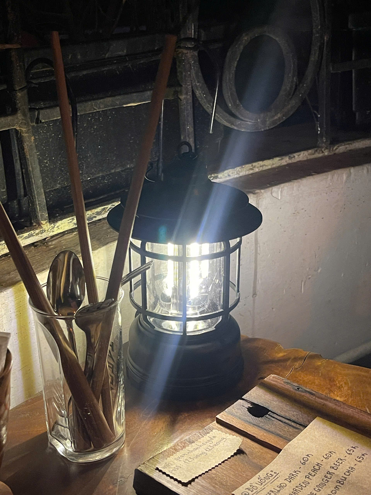
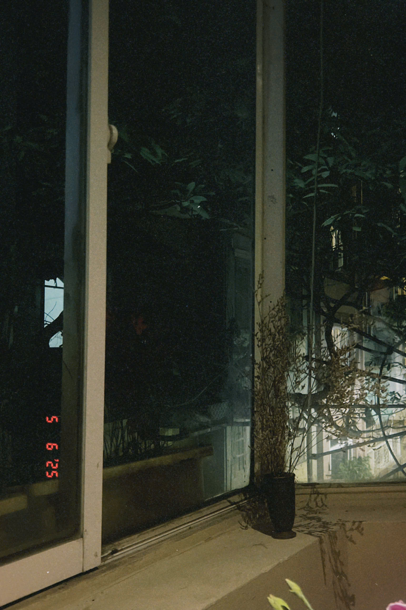

Em sẽ không nghe cái này đâu. Tôi biết. Cho nên mới nói được.

Tôi bắt đầu bằng chuyện nhìn, vì cả câu nằm ở đó.

Hồi còn yêu nhau, tôi nhìn em theo kiểu của người được phép nhìn. Nhìn em ngủ gục trên vai tôi trong xe buýt. Nhìn em cắm cúi bóc từng hạt lạc, bóc xong thì dồn hết sang bát tôi, rồi bảo ’em không đói’. Nhìn không cần lý do.

Sau khi chia tay, tôi vẫn nhìn, nhưng là kiểu khác. Kiểu của người rất giỏi giả vờ đang nhìn chỗ khác. Nhìn qua dòng ‘hoạt động lần cuối’ bé tí dưới tên em. Nhìn qua mấy tấm ảnh bạn chung đăng, nơi em chỉ đứng ở góc, nửa mặt bị che bởi cái ly. Có đêm tôi thuộc từng chi tiết của những tấm ảnh đó, như thuộc một con đường.

Hai năm. Nghe thì không dài. Không đủ để gọi là cả một đời, mà đủ để thành thói quen.

Tôi nhớ những thứ không ai ghi vào kỷ niệm. Cái ô chung của hai đứa, hỏng một gọng, mưa là đứa nào cũng ướt nửa người mà không đứa nào chịu mua cái mới. Cái khuyên tai em hay quên lại trên bàn tôi, hết cái này đến cái khác, đến mức tôi có hẳn một cái hộp nhỏ để đựng.

Em có một thói quen. Mỗi lần sắp nói câu mình không chắc, em thở ra một hơi nhỏ. Tôi nghe được cái hơi thở đó từ cách em ngồi, trước khi em mở miệng. Hai năm là đủ để một người học thuộc hơi thở của người kia.

Và đó cũng là cái đáng sợ. Học thuộc rồi, thì lúc người ta không còn ở đó, mình vẫn nghe thấy.

Sau khi chia tay rồi, tôi biết tin em đi du học.

Điều làm tôi ngỡ ngàng không phải em đi. Du học là chuyện tốt, là chuyện em xứng đáng, tôi mừng. Điều làm tôi ngỡ ngàng là, em đã đi được một thời gian rồi, mà thế giới của tôi vẫn quay như thể em còn ở đây. Vẫn mặc định em đang ở đâu đó cách tôi vài quận.

Hóa ra em ở cách tôi mấy múi giờ.

Tối đó về, tôi mở lại mấy tấm ảnh bạn chung. Lần này tôi nhìn kỹ hơn. Trong một tấm, bên cạnh em có một người. Không ai nắm tay ai. Chỉ là một cái bóng đứng sát, một cái ly đặt gần hơn mức người lạ sẽ đặt.

Tôi không biết người đó là ai. Có thể là bạn học. Có thể là hơn. Tôi chỉ biết, cái cách em nghiêng đầu trong tấm ảnh đó, tôi từng thấy rồi. Là cách em nghiêng đầu khi thấy an toàn.

Và có lẽ tôi cũng không có tư cách để biết.

Một ngày nào đó nếu như em không còn thấy tôi nhìn về phía em nữa.

Mà thật ra, em đâu có thấy tôi nhìn ngay bây giờ. Em ở bên kia nửa vòng Trái Đất. 

Có thể em không biết, nhưng có thể em vẫn cảm được, trong những lúc rất lẻ. Như một ngày em tự nhiên nhớ một con đường cũ, một bài hát cũ, rồi tự hỏi sao lại nhớ. Có lẽ không vì gì cả. Có lẽ vì ở một nơi nào đó, có người đang cầm một cái hộp khuyên tai, nghĩ về em.

Và một ngày, cái cảm giác đó sẽ không còn. Không phải vì em chủ động gạt đi. Chỉ vì tôi đã thôi nhìn lại.

Và tôi lo một điều. Lo rằng ngày đó, em sẽ hiểu sai.

Em có thể nghĩ: à, thì ra hồi đó anh ấy cũng không yêu nhiều lắm, chia tay rồi quên nhanh. Hoặc nghĩ: hai năm bên nhau mà một trận cãi cũng không đủ để anh ấy gọi lại, chắc chẳng là bao nhiêu.

Cho nên tôi nói câu này, cho đúng ngày đó.

Mong em hãy tin rằng tôi đã yêu em nhiều hơn những gì em biết.

Em biết bao nhiêu thì tôi đã cho em biết bấy nhiêu. Hai năm, tôi nói ‘anh yêu em’ rất nhiều lần. Nhưng ba chữ ‘anh xin lỗi’ thì tôi tiếc, tiếc đến mức để nó nằm lại trong cổ họng đúng cái đêm cần nhất. 

Nên cái ‘nhiều hơn em biết’ kia, có lẽ nên đọc thành hai nửa. Tôi yêu em, thật, nhiều hơn những gì một người cãi nhau xong im lặng suốt bao lâu có thể chứng minh. Và nửa thứ hai, cái phần tình yêu đó em không biết, vì tôi đã giữ nó lại sau lớp kiêu hãnh.

Nếu một ngày em không còn thấy tôi nhìn về phía em nữa. Chắc em sẽ cảm ơn tôi vì đã buông cho em? 

Tôi không biết ngày đó là bao giờ. Tôi cũng không vội. Tôi từng nghĩ phải quên cho nhanh mới là mạnh. Giờ thì nghĩ khác. Cái gì mất hai năm mới có, thì cũng có quyền mất một khoảng thời gian dài mới tàn.
