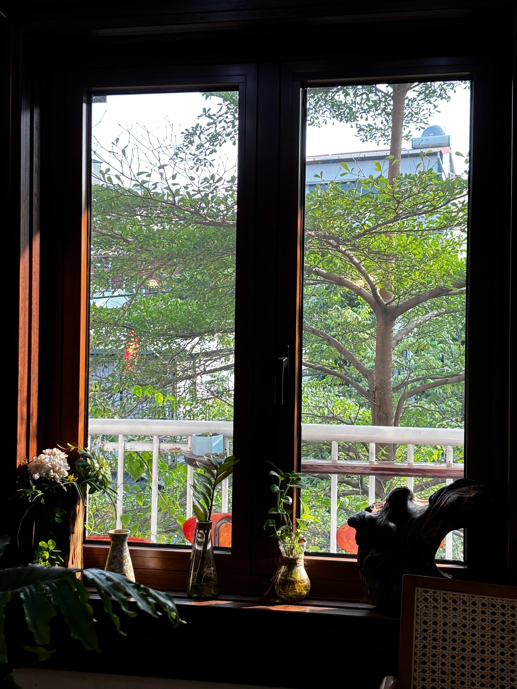
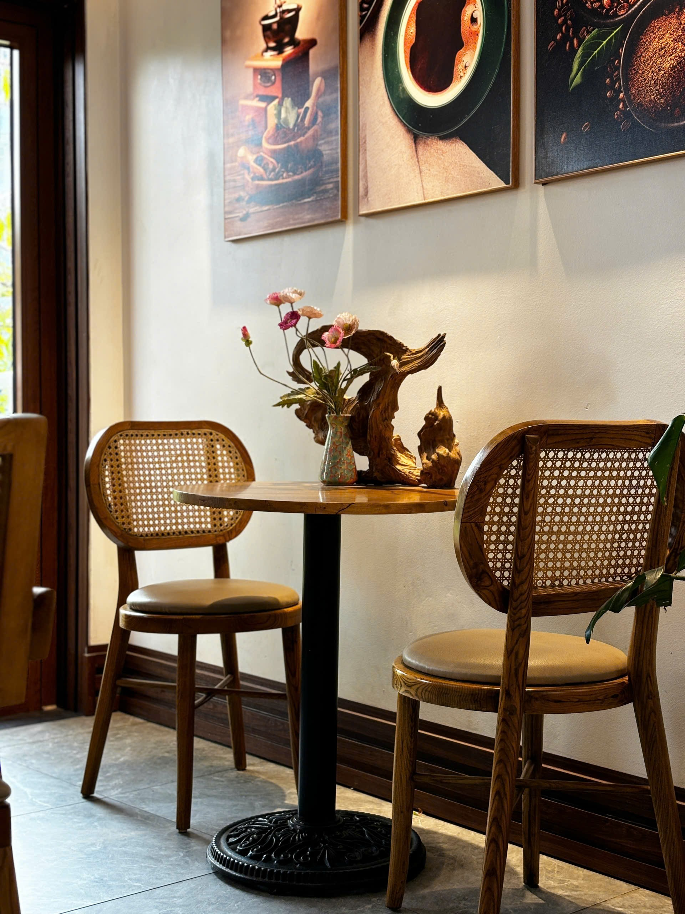
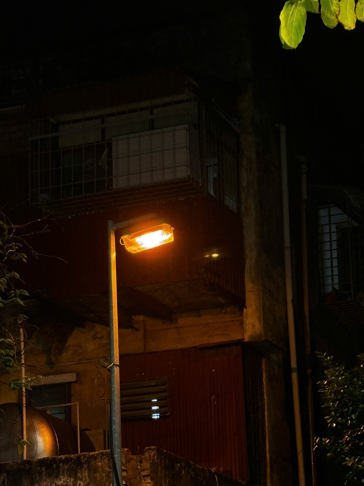

Mười hai giờ lẻ mấy phút rồi. Chính thức sang tuổi hai mươi sáu.

Tối nay có chiếc bánh nhỏ. Tôi tự mua chiều nay ở tiệm đầu ngõ. Cô bán hàng hỏi: ‘Ghi chữ gì lên bánh không anh?’ Tôi đứng đó, nghĩ khá lâu, rồi nói: ‘Không cần đâu.’ Cô gật đầu, thêm cho một cây nến.

Một cây thôi. Không phải hai mươi sáu cây. Mà nói thật, tôi thấy một cây hợp hơn. Hai mươi sáu cây thì thành đám cháy.

Thường người ta nhìn lại một năm bằng những chuyện lớn. Thăng chức, đi xa, mua nhà, cưới ai đó. Tôi thử làm khác. Tôi mở điện thoại, lướt lại thư viện ảnh từ tháng Mười Một năm ngoái đến giờ.

Và biết không, hầu như không có tấm nào là chuyện lớn.

Có một tấm chụp cái bát phở bị đổ nửa, vì tôi vừa chụp vừa đụng tay. Có một tấm chụp trần nhà một đêm mất ngủ, chẳng hiểu sao tôi lại chụp. Có tấm chụp bảng hiệu một quán cà phê đã đóng cửa, vì trông nó cô đơn. Có tấm chụp một con mèo hoang nằm trên mui xe, nhìn tôi như nhìn nhân viên thuế.

Hơn hai nghìn tấm ảnh. Tôi tìm mãi một tấm ‘khoảnh khắc đáng nhớ’ để làm điểm nhấn cho đêm nay, không có. Cả năm của tôi là một chuỗi những ngày thường. Lúc đầu tôi hơi hụt hẫng. Rồi tôi nghĩ lại. Nếu một năm của mình chỉ có ba bốn khoảnh khắc đáng quay phim, thì hơn ba trăm ngày còn lại là gì? Là rác à? Không. Chính là phần lớn cuộc đời. Cái phần không ai chụp ảnh cho đẹp, nhưng mình đã sống thật.

\_\_\_\_\_\_\_\_\_\_\_\_\_\_\_\_\_\_\_\_\_\_\_\_\_\_\_\_\_\_\_\_\_\_\_\_\_\_\_\_\_\_\_\_\_\_\_\_\_\_\_\_

Hai mươi sáu nghe chẳng có gì đặc biệt. Hai mươi lăm thì còn có vẻ là một cột mốc, người ta hay gọi là một phần tư thế kỷ. Hai mươi sáu là cái tuổi người ta quên chúc.

Nhưng tôi thấy nó có một cái hay. Hai mươi lăm là tuổi người ta hay ngồi tính toán, đếm xem mình có gì, thiếu gì. Còn hai mươi sáu thì như ngày đầu tiên sau mốc đó. Mình đã đếm xong rồi, chẳng ai chấm điểm nữa, chỉ còn việc đi tiếp.

Năm ngoái, đúng giờ này, tôi cũng ngồi một mình thế này. Tôi nhớ mình tự hứa một vài điều. Sáng nay tôi mở ghi chú ra tìm lại. Thấy mình viết đúng ba dòng.

Dòng một: ngủ trước mười hai giờ.

Giờ này là mười hai giờ ba mươi tám.

Dòng hai: uống đủ nước. Dòng ba: học một thứ gì đó chỉ vì thích.

Dòng một thì tôi thất bại thảm hại, khỏi bàn. Dòng hai thì tôi mua một cái bình nước to, dùng được đúng ba tuần, giờ nó nằm trên nóc tủ, phủ bụi. Còn dòng ba...

Dòng ba thì tôi làm được. Mà nó không giống điều tôi nghĩ khi viết ra.

Nhìn lại một năm, tôi thường chỉ đếm những thứ mình có thêm. Tối nay tôi muốn đếm cả những thứ mình đã mất.

Tôi mất một vài thói quen. Thói quen kiểm tra điện thoại lúc mới thức dậy, giờ đã bớt. Thói quen đi một con đường quen đến công ty, tôi đổi sang đường khác từ tháng Tư, không có lý do gì rõ ràng, chỉ là thấy cần đổi.

Tôi mất vài người ra khỏi cuộc sống hằng ngày.

Tôi mất cả một vài ý định lớn. Có cái tôi tưởng mình sẽ làm trong năm nay, giờ nhìn lại, hóa ra chưa bao giờ bắt đầu.

Và tôi mất đi, một cách rất lặng lẽ, cái cảm giác rằng mình phải biết trước mọi thứ. Năm ngoái, tôi còn nghĩ hai mươi lăm tuổi là phải có kế hoạch, phải có hướng. Năm nay tôi chỉ có... những tuần lễ. Mỗi tuần một ít.

\_\_\_\_\_\_\_\_\_\_\_\_\_\_\_\_\_\_\_\_\_\_\_\_\_\_\_\_\_\_\_\_\_\_\_\_\_\_\_\_\_\_\_\_\_\_\_\_\_\_\_\_

Nếu phải chọn một ngày duy nhất của năm qua để kể, tôi sẽ không chọn ngày đẹp nhất. Tôi chọn một ngày thứ Ba cuối tháng Sáu.

Không có gì xảy ra cả. Trời oi. Tôi tan làm muộn, bụng đói, đi bộ ra bến xe, ngang qua một xe bánh mì đang sắp dọn. Chú bán hàng còn lại đúng một ổ. Chú nói: ‘Cậu lấy đi, đằng nào cũng bỏ.’ Tôi trả tiền, chú không nhận. Chú bảo: ‘Ăn cho khỏe.

Tôi đứng ăn ổ bánh mì đó ở bến xe, giữa tiếng còi và mùi khói. Ăn hết. Rồi tự nhiên thấy... mình ổn. Không phải ổn kiểu có tin vui, có giải thưởng. Chỉ là ổn kiểu bụng đã no, chân đã mỏi, và có một người xa lạ vừa tử tế với mình mà không cần lý do.

Tôi nhớ ngày hôm đó hơn nhiều ngày lẽ ra đáng nhớ. Có lẽ vì lúc đó tôi không bận làm gì khác ngoài việc có mặt.

Tôi nghĩ nếu năm qua dạy tôi một điều, thì đó là khi hạnh phúc hay đến vào những lúc mình không kịp đón. Nó đứng ở một xe bánh mì, mặc áo mưa, chờ tôi đi ngang qua.

\_\_\_\_\_\_\_\_\_\_\_\_\_\_\_\_\_\_\_\_\_\_\_\_\_\_\_\_\_\_\_\_\_\_\_\_\_\_\_\_\_\_\_\_\_\_\_\_\_\_\_\_

Nến tan gần hết rồi. Tôi sẽ nói với người mình của năm sau, đúng một đêm như đêm nay, có thể cũng ngồi một mình, có thể không.

Tôi không biết ông đang ở đâu, làm gì, có ai bên cạnh không.

Tôi chỉ muốn nhờ ông vài việc nhỏ.

Đừng cố giải thích với ai tại sao mình chọn sống theo cách này. Nếu ai hỏi, cứ nói ‘tôi đang thử’. Đó là câu trả lời trung thực nhất tôi có.

Nếu ông có ngày tệ, đừng gọi nó là thất bại. Cứ gọi nó là một ngày. Ngày nào rồi cũng qua, và qua thật nhanh, nhanh hơn ông tưởng.

Nếu ông còn ngủ sau mười hai giờ, tôi hiểu. Tôi sẽ không trách.

Và nếu năm tới của ông cũng chỉ toàn những ngày thường, như năm nay của tôi, thì xin ông đừng thấy thiếu. Tôi đã nhìn lại cả ngàn tấm ảnh, và tôi có thể nói với ông: những ngày thường chính là phần thật nhất của đời mình.

Cứ ăn bánh mì khi người ta cho. Cứ giữ ba tiếng cho riêng mình.

Cứ là mình thôi.

 

 
